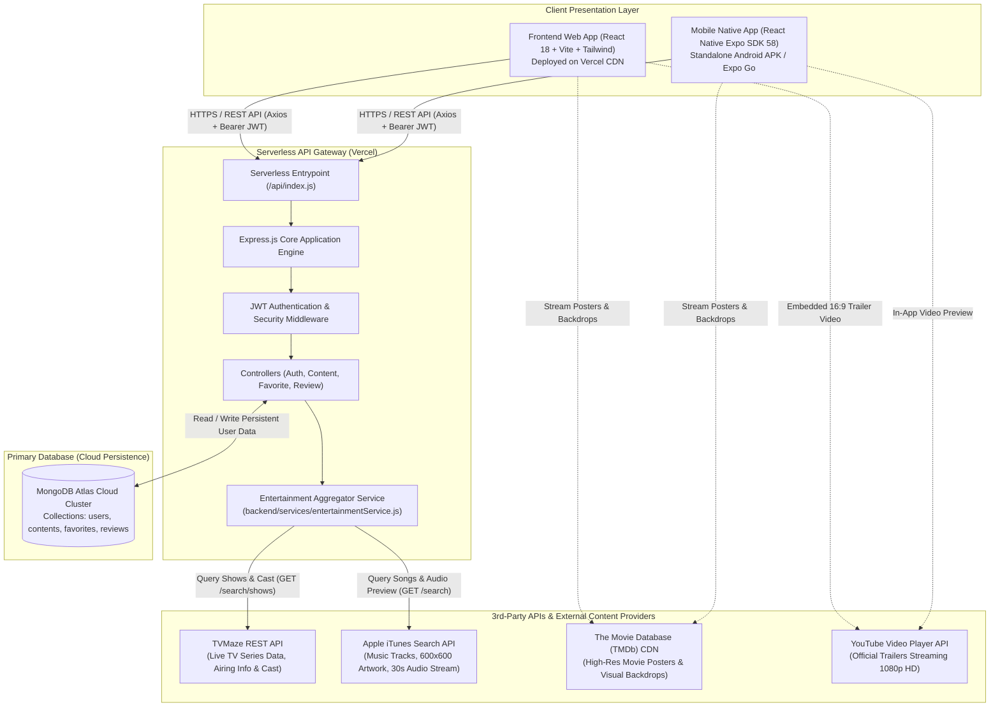
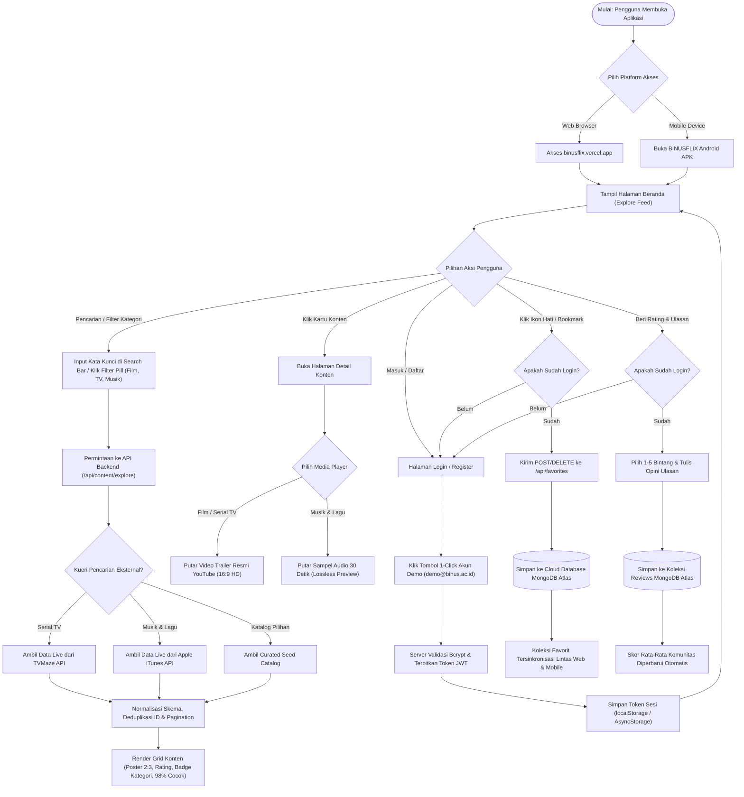

# 🎬 BINUSFLIX — Web & Mobile Entertainment Platform
### Tugas Akhir Pemrograman Web & Mobile — BINUS University

Aplikasi katalog dan agregator hiburan terpadu (Film Layar Lebar, Serial TV, dan Musik) yang mencakup **Backend REST API Serverless**, **Frontend Web SPA (React)**, dan **Mobile Application (React Native Expo)** yang saling terintegrasi secara *real-time*.

---

## 🌐 Tautan Akses & Live Deployment

| Komponen | Platform / Host | URL / Tautan Akses | Keterangan |
| :--- | :--- | :--- | :--- |
| **Frontend Web** | Vercel CDN | [https://binusflix.vercel.app](https://binusflix.vercel.app) | Aplikasi web responsif untuk Desktop & Mobile Browser |
| **Backend REST API** | Vercel Serverless | [https://binusflix-api.vercel.app](https://binusflix-api.vercel.app) | Base URL API gateway publik |
| **API Health Check** | Vercel Serverless | [https://binusflix-api.vercel.app/api/health](https://binusflix-api.vercel.app/api/health) | Endpoint cek uptime & status database cloud |
| **API Explore (Pagination)** | Vercel Serverless | [https://binusflix-api.vercel.app/api/content/explore?page=1&limit=10](https://binusflix-api.vercel.app/api/content/explore?page=1&limit=10) | Contoh endpoint katalog berpaginasi |
| **Download Android APK** | Expo EAS CDN | [Unduh Langsung APK v1.0.0](https://expo.dev/artifacts/eas/0EQ_KfHEjSmYLjKIx8GJFUXihfudxFjuDcf_nVcocNY.apk) | Berkas standalone APK siap pasang di HP Android |
| **EAS Build Dashboard** | Expo EAS | [Expo Build Dashboard (f7cb5a6c)](https://expo.dev/accounts/kyy27/projects/binusflix/builds/f7cb5a6c-1c39-409e-b471-d1a32496c27a) | Dasbor manajemen cloud build Expo |
| **GitHub Release v1.0.0** | GitHub Releases | [Release v1.0.0 Resmi](https://github.com/kikik27/binusflix/releases/tag/v1.0.0) | Catatan rilis v1.0.0 dan distribusi APK |

---

## 🔑 Akun Demo Pengujian (Pre-Seeded)

Aplikasi telah dilengkapi data awal pengguna di MongoDB Atlas. Tombol interaktif **"1-Click Isi Otomatis"** tersedia di halaman login web maupun mobile:
- **Email:** `demo@binus.ac.id`
- **Password:** `password123`
- **Username:** `binusian_user`
- **Nama Akun:** Binus Student Demo

---

## 🏗️ 1. Diagram Arsitektur Sistem (Architecture Diagram)

Sistem BINUSFLIX menggunakan pola arsitektur **Serverless Hybrid Aggregator**. Frontend Web dan Aplikasi Mobile mengakses satu backend gateway terpadu yang memadukan penyimpanan internal cloud (MongoDB Atlas) dengan penyedia API eksternal pihak ketiga (Third-Party APIs):



---

## 🔄 2. Diagram Alur Pengguna (User Diagram)

Diagram berikut merepresentasikan alur interaksi pengguna (*user journey*) dari pertama kali membuka aplikasi, melakukan pencarian konten lintas sumber, memutar trailer/musik, autentikasi sesi, mengelola daftar favorit, hingga mengirim ulasan komunitas:



---

## 🔌 3. Integrasi Data Pihak Ketiga (3rd-Party APIs) & Cara Kerjanya

Untuk menghadirkan katalog multimedia yang kaya, dinamis, dan realistis, BINUSFLIX tidak hanya mengandalkan database statis, melainkan mengintegrasikan beberapa layanan API pihak ketiga melalui modul [`backend/services/entertainmentService.js`](backend/services/entertainmentService.js):

### A. Layanan Pihak Ketiga yang Terintegrasi
1. **TVMaze Public REST API** (`https://api.tvmaze.com`)
   - **Fungsi:** Mengambil data serial televisi global secara dinamis saat pengguna mencari judul serial TV.
   - **Data yang Diambil:** Nama serial, sinopsis alur cerita (summary), tanggal tayang perdana, rata-rata rating pemirsa, genre, network/web channel pemroduksi, dan daftar pemeran utama (*cast members*).
2. **Apple iTunes Search API** (`https://itunes.apple.com`)
   - **Fungsi:** Menghubungkan platform dengan katalog musik global dari Apple Music / iTunes.
   - **Data yang Diambil:** Judul lagu (*track name*), nama musisi/artis, nama album, tanggal rilis, durasi lagu, artwork sampul resolusi tinggi (ditingkatkan otomatis dari 100x100 ke 600x600 px), serta **URL streaming sampel audio resmi 30 detik (AAC/MP4 preview)**.
3. **The Movie Database (TMDb) CDN** (`https://image.tmdb.org/t/p/...`)
   - **Fungsi:** Menyajikan poster vertikal beresolusi tinggi (rasio 2:3) dan backdrop lanskap sinematik berformat Ultra HD untuk film-film unggulan.
4. **YouTube Embedded Player API** (`https://www.youtube.com/embed/...`)
   - **Fungsi:** Menyediakan pemutaran trailer video resmi beresolusi 1080p Full HD secara responsif dalam aspek rasio 16:9 pada modal trailer web dan preview screen mobile.

---

### B. Mekanisme & Cara Kerja Integrasi

Sistem backend mengimplementasikan pola **Hybrid Dynamic Aggregator** dengan alur kerja sebagai berikut:

```text
[Permintaan Klien]
      │
      ▼
[Cek Parameter: 'type' & 'search']
      │
      ├──> (1) Ambil Curated Base Catalog (Fast In-Memory / Cold-Start Cache)
      │
      └──> (2) Jika ada kata kunci pencarian ('search'):
                 ├──> Request paralel ke TVMaze API (axios timeout 4000ms)
                 └──> Request paralel ke Apple iTunes API (axios timeout 4000ms)
                           │
                           ▼
                 (3) Data Normalization Layer
                     Memetakan format JSON yang berbeda dari tiap penyedia 
                     menjadi format data tunggal yang seragam (Unified Content Schema)
                           │
                           ▼
                 (4) ID Deduplication & Array Merge
                     Menghindari duplikasi konten menggunakan Map berbasis unique ID
                           │
                           ▼
                 (5) Pagination Engine (.skip() & .limit())
                     Memotong hasil sesuai parameter 'page' dan 'limit' serta 
                     menghitung totalItems, totalPages, dan flag hasMore
                           │
                           ▼
                 [Kirim Response JSON Terstandarisasi ke Web & Mobile]
```

1. **Normalisasi Data Terpadu (*Unified Schema Mapping*):**
   Setiap data mentah dari TVMaze (`s.name`, `s.image.original`) atau iTunes (`t.trackName`, `t.artworkUrl100`) ditransformasikan oleh backend menjadi format model terstandarisasi:
   ```javascript
   {
     id: `tv-${s.id}` atau `music-${t.trackId}`,
     contentType: 'tv' | 'music' | 'movie',
     title: string,
     subtitle: string,
     overview: string,
     posterUrl: string,
     backdropUrl: string,
     rating: number,
     genre: string,
     previewUrl: string (khusus audio musik),
     trailerUrl: string (trailer YouTube)
   }
   ```
2. **Resiliensi & Toleransi Kegagalan (*Graceful Degradation*):**
   Setiap pemanggilan HTTP eksternal dibatasi waktu henti (*timeout*) selama 4 detik dan dibungkus blok `try...catch`. Jika API TVMaze atau iTunes mengalami kendala koneksi atau rate limit, backend secara transparan akan tetap mengembalikan data katalog terkurasi (*curated fallback*) sehingga antarmuka pengguna tidak pernah mengalami crash atau layar kosong (*zero downtime*).

---

## 📡 Dokumentasi Endpoint REST API

Host Publik: `https://binusflix-api.vercel.app`

### Format Response Standard & Pagination
Endpoint yang mengembalikan daftar item (seperti `/api/content/explore` dan `/api/favorites`) menggunakan format pagination:
```json
{
  "success": true,
  "count": 10,
  "pagination": {
    "page": 1,
    "limit": 10,
    "totalItems": 18,
    "totalPages": 2,
    "hasMore": true
  },
  "data": [ ... ]
}
```

### Ringkasan Endpoint

| Method | Endpoint | Query / Body Params | Keterangan | Auth |
| :--- | :--- | :--- | :--- | :--- |
| `GET` | `/api/health` | - | Cek uptime server & status koneksi MongoDB | Tidak |
| `POST` | `/api/auth/register` | `{ username, email, password, fullName }` | Mendaftarkan akun mahasiswa baru | Tidak |
| `POST` | `/api/auth/login` | `{ email, password }` | Login & terbitkan token JWT | Tidak |
| `GET` | `/api/auth/me` | - | Mengambil data profil user yang sedang login | Ya (Bearer) |
| `GET` | `/api/content/explore` | `type`, `search`, `page`, `limit` | Mengambil katalog teragregasi dengan pagination | Tidak |
| `GET` | `/api/content/featured` | - | Mengambil banner unggulan billboard | Tidak |
| `GET` | `/api/content/detail/:type/:id` | - | Mengambil detail konten, trailer, & ulasan | Opsional |
| `GET` | `/api/favorites` | `type`, `page`, `limit` | Mengambil daftar favorit pengguna | Ya (Bearer) |
| `POST` | `/api/favorites` | `{ contentId, contentType, title, ... }` | Menambahkan konten ke koleksi favorit | Ya (Bearer) |
| `DELETE`| `/api/favorites/:contentId` | - | Menghapus konten dari daftar favorit | Ya (Bearer) |
| `GET` | `/api/reviews/:contentId` | `page`, `limit` | Mengambil ulasan komunitas pada konten | Tidak |
| `POST` | `/api/reviews` | `{ contentId, contentType, rating, reviewText }` | Mengirimkan ulasan & skor bintang (1–5) | Ya (Bearer) |

---

## 💻 Panduan Menjalankan Secara Lokal

### 1. Persiapan Database & Backend
```bash
cd backend
npm install
cp .env.example .env    # Konfigurasikan MONGO_URI dan JWT_SECRET
npm run seed            # Menjalankan seeder data awal ke MongoDB Atlas
npm run dev             # Server Express aktif di http://localhost:5000
```

### 2. Frontend Web (React + Vite)
```bash
cd frontend
npm install
npm run dev             # Aplikasi web aktif di http://localhost:5173
```

### 3. Mobile App (React Native Expo)
```bash
cd mobile
npm install
npx expo start
```
- Pindai QR Code dengan aplikasi **Expo Go** pada perangkat fisik Android atau iOS.
- Tekan `w` di terminal untuk menjalankan versi web-mobile.

#### Build Standalone Android APK (EAS Cloud Build)
```bash
cd mobile
npx eas build -p android --profile preview
```

---

## 📂 Struktur Direktori Repositori

```
binusflix/
├── backend/            # Express.js REST API & MongoDB Atlas
│   ├── api/            # Serverless handler untuk deployment Vercel
│   ├── config/         # Konfigurasi koneksi Mongoose ke MongoDB Atlas
│   ├── controllers/    # Controller logika bisnis (Auth, Content, Favorite, Review)
│   ├── middleware/     # JWT Authentication & error handler middleware
│   ├── models/         # Skema Mongoose (User, Content, Favorite, Review)
│   ├── routes/         # Express Route Handlers
│   ├── services/       # Aggregator Service integrasi TVMaze & iTunes API
│   ├── seed.js         # Script seeder data awal MongoDB
│   └── server.js       # Entry point Express lokal
├── frontend/           # Aplikasi Web SPA (React 18 + Vite + Tailwind CSS)
│   ├── src/
│   │   ├── api/        # Axios HTTP client & JWT interceptor
│   │   ├── components/ # Komponen UI (Navbar, HeroBanner, ContentCard, TrailerModal)
│   │   ├── context/    # AuthContext (State sesi login & profil pengguna)
│   │   └── pages/      # Halaman (HomePage, DetailPage, FavoritesPage, LoginPage, ProfilePage)
│   └── vercel.json     # Konfigurasi SPA rewrite Vercel
├── mobile/             # Aplikasi Mobile Native (React Native + Expo SDK 58)
│   ├── src/
│   │   ├── api/        # Mobile Axios client
│   │   ├── components/ # Komponen native ContentCard
│   │   ├── constants/  # Theme warna & default API endpoint
│   │   ├── context/    # AuthContext & token storage AsyncStorage
│   │   ├── navigation/ # React Navigation v7 (Stack & Bottom Tab)
│   │   └── screens/    # Layar (HomeScreen, DetailScreen, FavoritesScreen, LoginScreen, ProfileScreen)
│   ├── app.json        # Konfigurasi Expo & EAS Project ID
│   └── eas.json        # Profil build cloud EAS (preview APK & production)
└── README.md           # Dokumentasi arsitektur, user diagram, & panduan teknis
```
