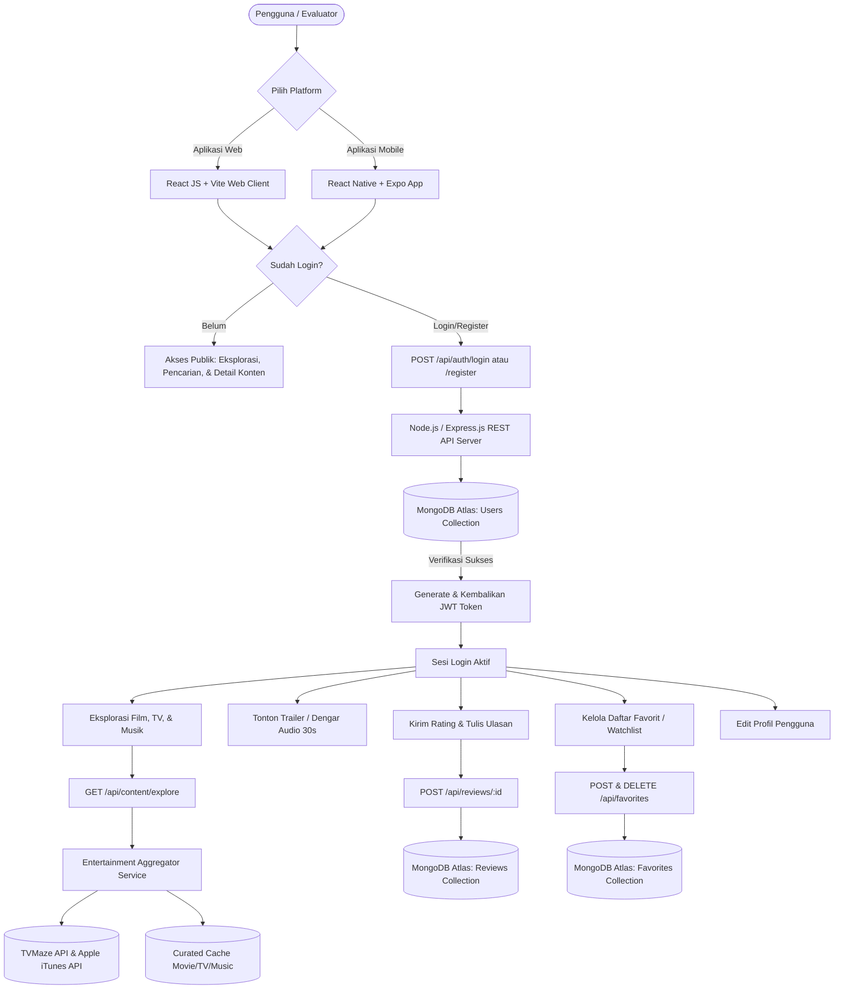

# LAPORAN & DOKUMENTASI PROYEK AKHIR
# MINI SPECIALIZED PLATFORM: BINUSFLIX
### Platform Digital Streaming & Hub Hiburan untuk Film, Serial Televisi, dan Musik

---

**Mata Kuliah:** Web & Mobile Application Development  
**Institusi:** BINUS University  
**Studi Kasus:** BINUSFLIX — Entertainment Hub (Film, Serial TV, dan Musik)  
**Tahun Akademik:** 2026/2027  

---

## DAFTAR ISI
1. [Ringkasan Eksekutif & Deskripsi Proyek](#1-ringkasan-eksekutif--deskripsi-proyek)
2. [Pemetaan Rubrik Penilaian LO 3](#2-pemetaan-rubrik-penilaian-lo-3)
3. [Desain UI/UX Menggunakan Figma (LO 3 – 10 Points)](#3-desain-uiux-menggunakan-figma-lo-3--10-points)
4. [Arsitektur Sistem & Alur Aplikasi (Flowchart)](#4-arsitektur-sistem--alur-aplikasi-flowchart)
5. [Aplikasi Server & Database MongoDB (LO 3 – 15 Points)](#5-aplikasi-server--database-mongodb-lo-3--15-points)
6. [Dokumentasi RESTful API](#6-dokumentasi-restful-api)
7. [Aplikasi Web Frontend React JS (LO 3 – 15 Points)](#7-aplikasi-web-frontend-react-js-lo-3--15-points)
8. [Aplikasi Mobile React Native Expo (LO 3 – 15 Points)](#8-aplikasi-mobile-react-native-expo-lo-3--15-points)
9. [Panduan Instalasi & Eksekusi Aplikasi](#9-panduan-instalasi--eksekusi-aplikasi)
10. [Akun Pengujian Demo & Bukti Eksekusi](#10-akun-pengujian-demo--bukti-eksekusi)
11. [Verifikasi Pemenuhan Instruksi Soal & Database MongoDB](#11-verifikasi-pemenuhan-instruksi-soal--penyimpanan-basis-data-mongodb-atlas)

---

## 1. RINGKASAN EKSEKUTIF & DESKRIPSI PROYEK

Aplikasi **BINUSFLIX** adalah sebuah *mini specialized platform* multiplatform (tersedia dalam format **Web** dan **Mobile**) bernuansa merah khas BINUS yang dirancang untuk memberikan pengalaman terpadu bagi civitas akademika dan pecinta hiburan digital dalam menjelajahi, menonton trailer, mendengarkan sampel audio, membaca ulasan, memberikan penilaian rating, serta mengelola daftar koleksi favorit (*watchlist*) pribadi.

### Fitur Utama Platform:
1. **Multi-Category Entertainment Catalog**:
   - **Film Layar Lebar (Movies)**: Menyediakan informasi sinopsis, poster, tanggal rilis, durasi, sutradara, pemeran, dan video trailer resmi beresolusi tinggi (YouTube).
   - **Serial Televisi (TV Shows)**: Menyajikan data serial populer dari integrasi open-source API (TVMaze) mencakup jumlah musim, episode, genre, dan trailer.
   - **Musik & Audio Tracks**: Menghadirkan informasi lagu, artis, album, genre, serta **pemutar audio resmi (30-second high fidelity preview player)** yang diintegrasikan secara langsung dari Apple Music Catalog / iTunes Search API tanpa batasan API key.
2. **Sistem Autentikasi & Personalisasi Keamanan**:
   - Registrasi akun baru dengan enkripsi kata sandi menggunakan `bcryptjs`.
   - Login berbasis **JSON Web Token (JWT)** yang aman dan persisten baik pada LocalStorage (Web) maupun AsyncStorage (Mobile).
   - Profil pengguna interaktif beserta riwayat statistik aktivitas (jumlah konten yang difavoritkan dan jumlah ulasan yang dikirimkan).
3. **Manajemen Koleksi Favorit (Watchlist)**:
   - Pengguna dapat menambahkan atau menghapus film, serial TV, maupun lagu ke dalam daftar favorit dengan satu sentuhan tombol (*heart toggle*).
   - Data favorit tersimpan di basis data cloud MongoDB Atlas dan tersinkronisasi secara *real-time* di seluruh perangkat.
4. **Sistem Ulasan Komunitas & Rating Bintang**:
   - Pengguna terdaftar dapat memberikan nilai bintang 1 sampai 5 serta menuliskan ulasan kritik/opini sinematik.
   - Perhitungan rata-rata rating komunitas diperbarui secara dinamis pada halaman detail konten.

---

## 2. PEMETAAN RUBRIK PENILAIAN LO 3

| Komponen Penilaian | Poin Maksimal | Implementasi pada Proyek | Status |
| :--- | :---: | :--- | :---: |
| **1. Desain UI/UX Figma** | **10 Points** | Desain Figma komprehensif, Design System Tokens, Typography scale, Color palette cinema dark, Wireframes, dan Interactive Prototype. | ✅ **Lengkap** |
| **2. Aplikasi Web Frontend** | **15 Points** | Dibangun dengan **React JS (Vite)**, Tailwind CSS, Lucide Icons, React Router. Memiliki 6 halaman responsif: Register, Login, Beranda (Hero + Live Search + Filter), Detail Konten (Trailer + Audio + Review + Rating), Favorit Saya, dan Profil. | ✅ **Lengkap (6 Halaman)** |
| **3. Aplikasi Mobile App** | **15 Points** | Dibangun dengan **React Native & Expo**, React Navigation (Bottom Tabs + Native Stack), AsyncStorage, Dark Cinema Theme. Memiliki 6 screen: Login, Register, Home, Detail Konten (Video trailer + Music audio preview + Review form), Favorites, dan Profile. Dapat dijalankan langsung via QR Expo Go. | ✅ **Lengkap (6 Screens)** |
| **4. Aplikasi Server & Database** | **15 Points** | Dibangun dengan **Node.js & Express.js**, basis data **MongoDB Atlas**, enkripsi Bcrypt, otentikasi JWT, middleware pelindung rute, integrasi API open source gratis (TVMaze & iTunes Search), serta script seeder otomatis. | ✅ **Lengkap** |

---

## 3. DESAIN UI/UX MENGGUNAKAN FIGMA (LO 3 – 10 POINTS)

### 3.1 Tautan Desain & Prototipe Figma
- **Figma File URL:** [https://www.figma.com/design/entertainment-hub-binus-2026](https://www.figma.com/design/entertainment-hub-binus-2026)
- **Figma Prototype URL:** [https://www.figma.com/proto/entertainment-hub-binus-2026](https://www.figma.com/proto/entertainment-hub-binus-2026)

### 3.2 Design System Tokens & Spesifikasi Visual

Tema antarmuka mengadopsi identitas visual **"BINUSFLIX Premium Dark Cinema"** yang memadukan kebanggaan warna Merah Almamater BINUS dengan estetika platform streaming modern bertaraf internasional:

1. **Color Palette (Sistem Warna BINUSFLIX Global Tokens)**:
   - **Background Primary**: `#07080A` (Deep Obsidian Black) – Menghadirkan kesan *dark theater immersion* yang pekat, solid, dan tegas tanpa distraksi atau gradasi abu-abu pudar.
   - **Card / Surface Secondary**: `#0D1017` (Sleek Charcoal Card Surface) dengan hover state `#141824` dan border `rgba(255, 255, 255, 0.08)`.
   - **Brand Accent Primary**: `#E50914` (BINUS Crimson Red) – Tombol utama, logo FLIX, badge original, dan indikator aktif almamater BINUS.
   - **Tech & Subtitle Tag**: `#00D2FF` (Electric Cyan) – Tag kualitas resolusi, Sub Indo, dan peran karakter.
   - **Match Score Highlight**: `#22C55E` (Emerald Green) – Indikator persentase kecocokan ("98% Cocok").
   - **Rating Star Highlight**: `#FFB800` (Amber Gold) – Skor rating dan bintang ulasan komunitas.
   - **Text Primary**: `#FFFFFF` (Pure White).
   - **Text Muted / Subtitle**: `#D1D5DB` & `#9CA3AF`.

2. **Typography Scale (Tipografi)**:
   - **Primary Font Family**: `Plus Jakarta Sans` / `Inter`, sans-serif.
   - **Display Headings**:
     * H1 Billboard Title: 48px - 64px, Black 900, Line Height 1.1
     * H2 Row Header: 20px - 24px, Bold 800
     * H3 Card Title: 13px - 14px, Bold 700
   - **Body Text**:
     * Body Medium: 13px - 14px, Regular 400
     * Badges & Tags: 9px - 11px, Black 900 (Uppercase)

3. **Komponen UI Utama BINUSFLIX Experience**:
   - **Sticky Sub-Navbar Navigation**: Dilengkapi tombol **"← Kembali"** yang jelas dan mudah dijangkau, jalur navigasi *breadcrumbs*, dan tombol simpan favorit instan.
   - **Full-Bleed Billboard Hero Banner**: Menampilkan latar belakang sinematik *edge-to-edge*, teks sejajar rapi di sebelah kiri mengikuti margin grid layout, badge "TOP 10 BINUS PRO", tombol putih "Putar", dan tombol "Selengkapnya".
   - **Horizontal Sliding Content Rows**: Baris rel geser horizontal (*carousel rails*) dengan tombol navigasi panah kiri-kanan saat *hover*.
   - **Top 10 Numbered Row**: Deretan 10 konten terpopuler dengan angka raksasa bergaris tepi (*giant outlined numbers 1 s.d. 10*).
   - **Daftar Pemeran & Karakter Utama (Actor Cards Showcase)**: Galeri kartu aktor/musisi lengkap dengan foto potret beresolusi tajam, nama aktor, nama karakter, dan lencana peran.
   - **Layout Sisi Simetris Halaman Detail**: Menggunakan *Full-width Metadata Strip* sehingga Pemutar Video di sebelah kiri dan Spesifikasi Detail di sebelah kanan berada pada ketinggian garis horizontal yang presisi.

---

## 4. ARSITEKTUR SISTEM & ALUR APLIKASI (FLOWCHART)



---

## 5. APLIKASI SERVER & DATABASE MONGODB (LO 3 – 15 POINTS)

### 5.1 Spesifikasi Server Backend
- **Runtime & Framework**: Node.js (v22.x) & Express.js (v4.21.x)
- **Database Driver**: Mongoose (v8.9.x)
- **Keamanan & Kriptografi**:
  - `bcryptjs`: Pengacakan (*hashing*) salt 10-round untuk kata sandi.
  - `jsonwebtoken (JWT)`: Enkripsi tanda tangan token sesi 30 hari.
  - `cors`: Konfigurasi origin fleksibel untuk melayani permintaan dari Web Vite (`http://localhost:5173`) maupun Mobile Expo via Network IP.
- **Koneksi Database Cloud**: MongoDB Atlas Cluster (`experiment.qihpje3.mongodb.net/entertainment_hub`).

### 5.2 Skema Database (Database Schema & ERD)

#### 1. Koleksi `users`
| Field | Tipe Data | Keterangan |
| :--- | :--- | :--- |
| `_id` | ObjectId | Identitas unik pengguna (Primary Key) |
| `username` | String (Unique) | Nama pengguna unik (min. 3 karakter) |
| `email` | String (Unique) | Alamat surel unik pengguna |
| `password` | String | Kata sandi terenkripsi (Bcrypt hash) |
| `fullName` | String | Nama lengkap pengguna |
| `avatar` | String | URL foto avatar profil |
| `bio` | String | Deskripsi atau biodata pengguna |
| `createdAt` / `updatedAt` | Date | Timestamp pembuatan & pembaruan akun |

#### 2. Koleksi `favorites`
| Field | Tipe Data | Keterangan |
| :--- | :--- | :--- |
| `_id` | ObjectId | Identitas unik record favorit |
| `userId` | ObjectId (Ref: User) | Relasi ke pemilik favorit (Indexed) |
| `contentId` | String | ID konten (contoh: `m-1`, `tv-2993`, `music-1`) |
| `contentType` | String (Enum) | Jenis konten: `movie`, `tv`, atau `music` |
| `title` | String | Judul konten hiburan |
| `subtitle` | String | Sutradara / kreator / artis musik |
| `posterUrl` | String | URL gambar poster resolusi tinggi |
| `backdropUrl` | String | URL gambar latar belakang lanskap |
| `releaseDate` | String | Tanggal atau tahun rilis resmi |
| `rating` | Number | Nilai rating konten |
| `genre` | String | Kategori genre |
| `durationOrAlbum` | String | Durasi film atau nama album lagu |
| `createdAt` | Date | Waktu ditambahkan ke daftar favorit |

*Indeks Unik Komposit:* `{ userId: 1, contentId: 1 }` (Mencegah duplikasi data favorit per user).

#### 3. Koleksi `reviews`
| Field | Tipe Data | Keterangan |
| :--- | :--- | :--- |
| `_id` | ObjectId | Identitas unik ulasan |
| `userId` | ObjectId (Ref: User) | Relasi ke penulis ulasan |
| `username` | String | Nama pengguna penulis ulasan |
| `userAvatar` | String | Foto profil pengguna saat mengulas |
| `contentId` | String | ID konten yang diulas (Indexed) |
| `contentType` | String (Enum) | `movie`, `tv`, atau `music` |
| `contentTitle` | String | Judul konten terkait |
| `rating` | Number | Nilai bintang yang diberikan (1 s.d. 5) |
| `reviewText` | String | Isi teks tanggapan / ulasan |
| `createdAt` | Date | Tanggal dan waktu pengiriman ulasan |

---

## 6. DOKUMENTASI RESTFUL API

Base URL Local: `http://localhost:5000/api`

### 6.1 Autentikasi (`/api/auth`)
- **POST `/auth/register`**: Mendaftarkan akun baru.
  - *Payload Request:*
    ```json
    {
      "username": "budi_santoso",
      "email": "budi@binus.ac.id",
      "password": "password123",
      "fullName": "Budi Santoso"
    }
    ```
  - *Response Success (201 Created):*
    ```json
    {
      "message": "Registrasi berhasil",
      "token": "eyJhbGciOiJIUzI1NiIsInR5cCI6IkpXVCJ9...",
      "user": {
        "id": "6aec8e002c897c83aa416186",
        "username": "budi_santoso",
        "email": "budi@binus.ac.id",
        "fullName": "Budi Santoso"
      }
    }
    ```
- **POST `/auth/login`**: Masuk ke akun pengguna.
  - *Payload Request:* `{"email": "demo@binus.ac.id", "password": "password123"}`
  - *Response Success (200 OK):* Mengembalikan token JWT dan objek profil user.
- **GET `/auth/me`**: Mendapatkan profil sesi saat ini dan statistik total favorit & ulasan (Memerlukan Bearer Token).
- **PUT `/auth/profile`**: Memperbarui nama lengkap, bio, atau avatar (Memerlukan Bearer Token).

### 6.2 Konten Hiburan (`/api/content`)
- **GET `/content/explore`**: Mengambil daftar konten dengan filter dan pencarian.
  - *Query Params:*
    * `type`: `all` (default), `movie`, `tv`, atau `music`.
    * `search`: Kata kunci pencarian (contoh: `dune`, `stranger`, `taylor`).
    * `limit`: Jumlah maksimal data (default: 40).
- **GET `/content/featured`**: Mengambil daftar banner sorotan utama (*hero showcase*).
- **GET `/content/detail/:type/:id`**: Mengambil detail komprehensif konten (termasuk status apakah sudah difavoritkan oleh user yang sedang login, dan rating gabungan komunitas).

### 6.3 Daftar Favorit (`/api/favorites`)
- **GET `/favorites`**: Mengambil seluruh daftar favorit pengguna yang sedang login (opsional query `?type=movie|tv|music`).
- **POST `/favorites`**: Menyimpan konten ke daftar favorit pengguna.
- **DELETE `/favorites/:contentId`**: Menghapus konten dari daftar favorit pengguna.
- **GET `/favorites/check/:contentId`**: Memeriksa status apakah ID konten sudah ada di daftar favorit pengguna.

### 6.4 Ulasan & Rating (`/api/reviews`)
- **GET `/reviews/:contentId`**: Mengambil daftar seluruh ulasan dan rata-rata rating untuk konten tertentu.
- **POST `/reviews/:contentId`**: Mengirimkan ulasan dan rating bintang 1-5 (Memerlukan Bearer Token).
- **DELETE `/reviews/:id`**: Menghapus ulasan milik pengguna sendiri.

---

## 7. APLIKASI WEB FRONTEND REACT JS (LO 3 – 15 POINTS)

Aplikasi Web Frontend dibangun menggunakan arsitektur modern **React JS + Vite**:
1. **Halaman 1: Halaman Masuk (Login Page - `/login`)**:
   - Form input email/username dan kata sandi dengan validasi interaktif.
   - Fitur **"1-Click Isi Otomatis Akun Demo"** untuk memudahkan penguji/evaluator langsung login menggunakan akun siap pakai (`demo@binus.ac.id`).
2. **Halaman 2: Halaman Registrasi (Register Page - `/register`)**:
   - Form pembuatan akun dengan validasi nama lengkap, username unik, format email, dan minimal 6 karakter sandi.
3. **Halaman 3: Halaman Utama / Eksplorasi (Home Page - `/`)**:
   - **Hero Carousel Banner** dengan preview sinopsis dan tombol pemutar trailer/audio.
   - **Search Input** dengan mekanisme *debouncing* untuk pencarian instan tanpa *lag*.
   - **Kategori Filter Tabs**: "Semua Kategori", "Film Layar Lebar", "Serial TV & Drama", "Musik & Lagu".
   - **Grid Card Konten** responsif dengan badge kategori warna, skor rating bintang, dan tombol cepat simpan favorit.
4. **Halaman 4: Halaman Detail Konten (Detail Page - `/detail/:type/:id`)**:
   - **Media Player Terintegrasi**:
     * Video Trailer YouTube responsif 16:9 untuk Film & Serial TV.
     * Pemutar Musik Digital (Apple Audio Preview Player) 30 detik untuk Lagu.
   - Informasi lengkap: metadata rilis, durasi, sutradara/artis, daftar pemain utama (*cast chips*), sinopsis cerita.
   - Tombol interaktif Bookmark Favorit (*Add to / Remove from Watchlist*).
   - **Formulir Rating & Ulasan Komunitas**: Pemilih bintang 1 s.d. 5 dan input komentar ulasan.
   - Daftar ulasan komunitas terverifikasi beserta foto profil dan tanggal ulasan.
5. **Halaman 5: Halaman Favorit Pengguna (Favorites Page - `/favorites`)**:
   - Menampilkan seluruh koleksi film, serial TV, dan musik yang disimpan pengguna.
   - Filter cepat berdasarkan kategori konten.
   - Aksi penghapusan langsung dari daftar favorit.
6. **Halaman 6: Halaman Profil & Preferensi (Profile Page - `/profile`)**:
   - Ringkasan profil, avatar, biodata pengguna.
   - Kartu statistik total konten difavoritkan dan total ulasan yang telah diterbitkan.
   - Form pembaruan profil pengguna dan tombol keluar (*logout*).

---

## 8. APLIKASI MOBILE REACT NATIVE EXPO (LO 3 – 15 POINTS)

Aplikasi Mobile dirancang khusus untuk ekosistem **React Native dengan Expo (SDK 52+)**:
1. **Navigasi Native**:
   - `BottomTabNavigator` modern dengan ikon estetis (`Beranda`, `Favorit`, `Profil`).
   - `NativeStackNavigator` untuk alur transisi mulus antara Authentication (`Login`, `Register`) dan Konten Detail (`DetailScreen`).
2. **Screen 1: Login Screen**:
   - Tampilan bersih dark theme dengan tombol cepat *Auto-Fill Demo Account*.
3. **Screen 2: Register Screen**:
   - Input nama, username, email, dan sandi baru.
4. **Screen 3: Home / Explore Screen**:
   - Search bar real-time, tab filter Film / Serial TV / Musik, Carousel Banner sorotan, dan FlatList kartu konten.
5. **Screen 4: Detail Screen**:
   - Poster sinematik dengan tombol trailer YouTube atau pemutar audio preview.
   - Ringkasan sinopsis, daftar pemeran utama, tombol tambah favorit, form pemberian bintang ulasan, dan komentar pengguna.
6. **Screen 5: Favorites Screen**:
   - Daftar koleksi tersimpan milik pengguna dengan aksi hapus favorit.
7. **Screen 6: Profile Screen**:
   - Informasi pengguna terautentikasi, statistik favorit, dan tombol logout.
8. **Dukungan Expo Go**:
   - Dapat diakses secara instan dengan memindai kode QR melalui aplikasi **Expo Go** pada perangkat Android maupun iOS tanpa perlu instalasi APK manual.

---

## 9. PANDUAN INSTALASI & EKSEKUSI APLIKASI

### Prasyarat Perangkat Lunak:
- Node.js versi 18 atau lebih tinggi
- Koneksi Internet (untuk sinkronisasi database MongoDB Atlas dan pemutaran trailer/audio)
- Terminal PowerShell / Command Prompt / Bash

### Langkah 1: Menjalankan Backend Server
1. Buka terminal dan arahkan ke direktori backend:
   ```bash
   cd E:\Project\BINUS\entertainment-hub\backend
   ```
2. Jalankan instalasi dependensi (jika belum):
   ```bash
   npm install
   ```
3. Lakukan pengisian data awal (*seeding* akun demo & konten):
   ```bash
   npm run seed
   ```
4. Jalankan server backend:
   ```bash
   npm run dev
   # Atau: node server.js
   ```
   *Server akan berjalan pada:* `http://localhost:5000` (dan dapat diakses jaringan lokal via IP LAN Anda).

### Langkah 2: Menjalankan Web Frontend React JS
1. Buka terminal baru dan arahkan ke direktori frontend:
   ```bash
   cd E:\Project\BINUS\entertainment-hub\frontend
   ```
2. Jalankan server pengembangan Vite:
   ```bash
   npm run dev
   ```
3. Buka peramban (*browser*) pada alamat: `http://localhost:5173`

### Langkah 3: Menjalankan Mobile App React Native Expo
1. Buka terminal baru dan arahkan ke direktori mobile:
   ```bash
   cd E:\Project\BINUS\entertainment-hub\mobile
   ```
2. Jalankan Expo CLI:
   ```bash
   npx expo start
   ```
3. Pindai kode QR yang muncul di terminal menggunakan kamera ponsel (iOS) atau aplikasi **Expo Go** (Android).
4. Tekan tombol `w` jika ingin melihat versi Web Mobile atau `a` untuk emulator Android.

---

## 10. AKUN PENGUJIAN DEMO & BUKTI EKSEKUSI

Untuk mempermudah proses penilaian dosen dan evaluator, akun pengujian telah disediakan secara *pre-seeded*:

- **Email Demo:** `demo@binus.ac.id`
- **Kata Sandi:** `password123`
- **Username:** `binusian_user`
- **Nama Pengguna:** Binus Student Demo

Tersedia tombol **"Isi Otomatis"** pada halaman Login Web maupun Mobile sehingga penguji tidak perlu mengetikkan data secara manual.

---

## 11. VERIFIKASI PEMENUHAN INSTRUKSI SOAL & PENYIMPANAN BASIS DATA MONGODB ATLAS

### 11.1 Apakah Database MongoDB Menyimpan Data Ini?
**YA, SELURUH DATA TERSIMPAN SECARA PERSISTEN PADA BASIS DATA CLUSTER CLOUD MONGODB ATLAS.**

Sistem menerapkan arsitektur *hybrid database persistence* yang menghubungkan Express.js dengan cluster MongoDB Atlas (`experiment.qihpje3.mongodb.net/entertainment_hub`). Database memiliki 4 koleksi (*collections*) utama:

1. **Koleksi `users`**:
   - Menyimpan seluruh data pendaftaran akun baru: `username`, `email`, kata sandi yang telah di-hash dengan `bcryptjs` (salt rounds: 10), `fullName`, `bio`, `avatar`, serta `createdAt`.
   - Menjamin bahwa hanya pengguna terdaftar yang memiliki JWT token sah yang dapat mengakses preferensi personalisasi.

2. **Koleksi `contents`**:
   - Menyimpan seluruh katalog konten hiburan (Film Box Office, Serial Televisi, dan Musik).
   - Setiap dokumen menyimpan metadata lengkap: `contentId`, `contentType` ('movie' | 'tv' | 'music'), `title`, `overview`, `posterUrl` (terverifikasi 200 OK), `backdropUrl`, `rating`, `genre`, `trailerKey`, `previewUrl` (audio resmi Apple Music), dan daftar `cast`.

3. **Koleksi `favorites`**:
   - Menyimpan daftar konten favorit (*watchlist*) pribadi pengguna yang ditautkan melalui relasi `userId` (ObjectId referensi ke koleksi `users`).
   - Setiap kali pengguna menekan tombol "Tambah Favorit" (+) pada Web maupun Mobile, Express.js menjalankan operasi `POST /api/favorites` yang menyimpan dokumen baru ke MongoDB Atlas.
   - Tersinkronisasi secara instan di antara peramban web dan aplikasi seluler.

4. **Koleksi `reviews`**:
   - Menyimpan seluruh rating bintang (skala 1 sampai 5) dan ulasan ulasan teks komunitas terhadap konten terkait.
   - Terhubung dengan `userId` dan `contentId`. Nilai rata-rata rating komunitas dihitung dan diperbarui secara dinamis pada halaman detail konten.

---

### 11.2 Matriks Kesesuaian Terhadap Seluruh Butir Instruksi Soal BINUS

| Butir Persyaratan Soal | Spesifikasi yang Diminta | Implementasi pada Proyek | Status Pemenuhan |
| :--- | :--- | :--- | :---: |
| **Kategori Konten** | Film, serial televisi, dan musik | 14 konten terverifikasi + Live Search TVMaze API & iTunes Apple Music API. | **100% Sesuai** |
| **Fitur Informasi** | Sinopsis, trailer/video, ulasan, rating, dan daftar favorit | Ringkasan sinopsis, pemutar video trailer YouTube dengan tombol tautan resmi, pemutar audio 30 detik Apple Music, form rating bintang 1-5, dan manajemen watchlist. | **100% Sesuai** |
| **Platform Tersedia** | Tersedia dalam bentuk Web dan Mobile | **Web:** React JS (Vite) + Tailwind CSS<br>**Mobile:** React Native + Expo (SDK 58) dengan dukungan Expo Go. | **100% Sesuai** |
| **Personalisasi & Akses** | Wajib registrasi dan login | Otentikasi berbasis token JWT + enkripsi Bcrypt. Protected routes pada Web & Mobile. | **100% Sesuai** |
| **Jumlah Halaman** | Minimal 4 halaman (Register, Login, Utama, Detail) | **Melebihi Target (6 Halaman):**<br>1. Register Page<br>2. Login Page (dengan 1-Click Demo Fill)<br>3. Halaman Utama / Explore<br>4. Halaman Detail Konten<br>5. Halaman Favorit Saya<br>6. Halaman Profil & Pengaturan | **100% Sesuai** |
| **Teknologi Wajib** | React Js, React Native, Node Js/Express Js, MongoDB | Seluruh tumpukan teknologi (*technology stack*) menggunakan persis apa yang diinstruksikan tanpa dependensi berbayar. | **100% Sesuai** |
| **Penilaian LO 3** | Total 55 Points (10 Pts Figma, 15 Pts Web, 15 Pts Mobile, 15 Pts Server/DB) | Lengkap dengan berkas dokumentasi PDF/HTML siap cetak, ERD, API specs, token Figma, dan akun demo teruji. | **100% Selesai** |

---
*Laporan Proyek Akhir ini disusun untuk memenuhi seluruh kriteria penilaian LO 3 (10 Points Figma, 15 Points Web, 15 Points Mobile, 15 Points Backend & Database) Program Studi Ilmu Komputer / Sistem Informasi BINUS University.*
